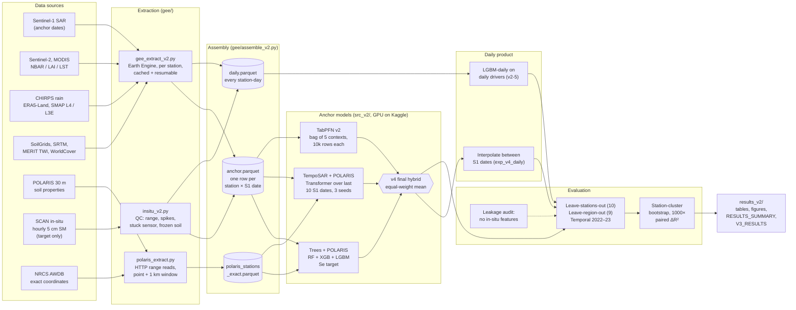

# Soil-moisture paper: improvement experiments, v2 pipeline and v3/v4 improvements

This package goes with the improvement report for *"Multi-Sensor Machine Learning Framework for Daily
Station-Scale Soil Moisture Reconstruction at Selected SCAN Sites"*. It estimates daily 5 cm soil moisture
(% volumetric) at SCAN stations from satellite, reanalysis and map data only (no in-situ input), and tests
it at stations, regions and years the models never saw.

Three generations live here:

| Generation | Data | Code | Results |
|---|---|---|---|
| v1: original improvement package | 2015–2018, public RZSM extracts | `src/` | `results/` |
| v2: full re-run (21 Oct 2026) | 2019–2023, 192 CONUS SCAN stations, Earth Engine | `gee/`, `src_v2/exp_v2_*` | `results_v2/RESULTS_SUMMARY.md` |
| v3/v4: improvements (22 Nov 2026) | v2 data + POLARIS 30 m soil maps | `src_v2/exp_v3_*`, `exp_v4_*`, `gee/polaris_extract.py` | `results_v2/V3_RESULTS.md` |

## Results: before → after

Satellite-only, at stations or regions never used in training (184 stations, 33,084 Sentinel-1 station-days).
RMSE in % vol. The paper model is the original 16-feature design; v2 is the pre-declared headline
`Hybrid(TabPFN+TempoSAR+Trees)`; v4 is the hybrid declared before its results
(`Hybrid(TabPFN-bag5 + TempoSAR+POLARIS + Trees+POLARIS(exact, Se))`).

| Test | Paper model | v2 hybrid | v4 final | v4 vs v2: ΔR² [95% CI] |
|---|---|---|---|---|
| Unseen stations: R² | 0.303 | 0.647 | **0.671** | +0.024 [+0.005, +0.045] |
| Unseen stations: RMSE | 10.23 | 7.28 | **7.03** | |
| Unseen stations: median station r | 0.578 | 0.810 | 0.803 | |
| Unseen regions: R² | 0.153 | 0.643 | **0.669** | +0.026 [+0.008, +0.045] |
| Unseen regions: RMSE | 11.27 | 7.32 | **7.05** | |
| Unseen years 2022–23: R² | 0.636 | 0.792 | 0.796 ¹ | +0.003 [+0.001, +0.005] |
| Daily, every labelled day, unseen stations: R² ² | −0.345 ³ | 0.625 | **0.654** | +0.028 [+0.008, +0.050] |
| Daily, non-Sentinel-1 days only: R² ² | | 0.621 | **0.650** | +0.029 [+0.008, +0.051] |

¹ Temporal test: TabPFN bagging only (`Hybrid(TabPFN-bag5+TempoSAR+Trees)`). POLARIS is not applied because the
test stations are seen in training. ² The hybrid's Sentinel-1-day estimates are linearly interpolated onto
every day (246,555 common days, `tables/v4_daily.csv`). ³ The paper's recursive daily loop, on its 16 stations.

What moved the numbers (details and every losing row in `results_v2/V3_RESULTS.md`):

* About 58 % of the remaining error at unseen stations is a constant per-station offset.
* **POLARIS 30 m soil properties** (porosity, texture, conductivity...) are the only change that clears the
  bootstrap noise floor (about ±0.01 R²): +0.02 R² at unseen stations and regions.
* TabPFN context bagging (×5) gives +0.003 to +0.005. Giving TempoSAR the soil maps adds a few thousandths
  more (not significant on its own).
* A station-mean correction from the existing features, exact NRCS coordinates for POLARIS, and a
  relative-wetness target all gave no gain.
* Median per-station r is unchanged (~0.81): the gains fix each station's level, not the day-to-day dynamics.

## Pipeline architecture



In-situ soil moisture enters only as the training target and the evaluation truth, never as an input to a
satellite-only model. Every fit (models, blend weights, corrections) happens inside the training folds,
grouped by station.

## Layout

```
data/raw/               v1 public input data (github.com/kashingtonDC/RZSM)
data/raw_v2/            v2 Earth Engine cache, SCAN hourly, station lists, POLARIS tables
                          stations_exact.csv              NRCS AWDB coordinates (21/184 stations > 1 km off)
                          polaris_stations[_exact].parquet POLARIS 10 variables x 2 depths, point + ~1 km mean
data/processed_v2/      anchor.parquet (S1 dates), daily.parquet (every day), paper_anchor.parquet
src/                    v1 package (2015-2018): build_dataset, common, deep (TempoSAR), exp1-4, figures
gee/
  gee_extract_v2.py     Earth Engine extraction (S1 linear + angle/orbit, S2 SCL mask, MODIS, CHIRPS,
                        ERA5-Land, SMAP L4/L3E, SoilGrids, MERIT TWI, WorldCover)
  insitu_v2.py          SCAN / USCRN / ISMN loaders with QC
  assemble_v2.py        exports + in-situ -> daily.parquet / anchor.parquet
  polaris_extract.py    POLARIS v1.0 over HTTP (no Earth Engine), resumable
src_v2/
  common_v2.py          feature sets, splits, tree models, TabPFN wrapper, summarize, log_progress
  deep_v2.py            TempoSAR wrapper
  exp_v2_1 .. exp_v2_6  v2: paper model + fix ladder, protocols, models, few-shot, daily, ablation
  exp_v3_tabpfn_bag.py  v3-1 TabPFN context bagging (GPU)
  exp_v3_station_mean.py v3-2 two-stage station-mean correction
  exp_v3_polaris_trees.py v3-3 trees + POLARIS
  exp_v4_trees.py       v4-1/2 trees + POLARIS at exact coordinates / relative-wetness target
  exp_v4_temposar.py    v4-3 TempoSAR with POLARIS static inputs (GPU)
  exp_v3_combine.py     merges all OOF predictions, builds hybrids, bootstrap -> tables/v3_models.csv
  exp_v4_daily.py       v4 hybrid on every day, split by Sentinel-1 / other days -> tables/v4_daily.csv
  summary_v2.py, summary_v3.py   generate RESULTS tables / V3_RESULTS.md (never edit those by hand)
  leakage_audit.py, make_figures_v2.py, run_v2.sh
colab/                  Colab notebook for the GPU run (bundles are git-ignored)
notebooks/              v1 experiments, Earth Engine extraction (Colab), training on v2 data
results/                v1 tables and figures
results_v2/             v2-v4 tables, figures, RESULTS_SUMMARY.md, V3_RESULTS.md, progress.md (log + pre-registrations),
                        paper_text_draft.md, citations.md
```

## Reproduce

```bash
.venv\Scripts\activate          # Python 3.12
cd soil_moisture_improvements

# v2 (about 5 h on i7-13620H + RTX 4050)
python gee/gee_extract_v2.py --stations data/raw_v2/stations_v2.csv --cache data/raw_v2/ee_cache   # ~1 h, resumable
python gee/insitu_v2.py scan data/raw_v2/stations_v2.csv data/raw_v2/scan_hourly                    # ~1 h, resumable
bash src_v2/run_v2.sh

# v3/v4 soil data (CPU, ~10 min each, resumable)
cd gee
python polaris_extract.py ../data/processed_v2/stations.csv ../data/raw_v2/polaris_stations.parquet
python polaris_extract.py ../data/raw_v2/stations_exact_for_polaris.csv ../data/raw_v2/polaris_stations_exact.parquet
cd ../src_v2

# GPU jobs (Kaggle GPU T4 x2, one process per GPU; ~1-2 h for bagging, ~17 min for TempoSAR)
python exp_v3_tabpfn_bag.py --protocol leave-stations-out      # also leave-one-region-out, temporal(2022-23)
python exp_v4_temposar.py --protocol leave-stations-out --polaris  # and without --polaris (control)

# CPU jobs (~1.4 min per fold on a 6-core laptop; run one tree script at a time with 8 GB RAM)
python exp_v3_station_mean.py && python exp_v3_station_mean.py --polaris
python exp_v3_polaris_trees.py
python exp_v4_trees.py --polaris exact --target raw     # also approx/se and exact/se

# Scoring and write-up (minutes)
python exp_v3_combine.py
python exp_v4_daily.py
python summary_v3.py            # writes results_v2/V3_RESULTS.md
```

Set `SM_PROC` / `SM_RES` to point at other data / results folders (used on Kaggle and Colab).
Never put `kaggle.json` or any token into a bundle; it is git-ignored.

## v1 package (2015–2018)

```bash
pip install numpy pandas pyarrow scikit-learn xgboost lightgbm torch geopandas matplotlib
cd src
python build_dataset.py && python exp1_baselines.py && python exp2_transfer.py AB
python exp2c_calibration.py && python exp3_stations_regions.py && python exp4_daily.py && python make_figures.py
```

## Ground rules

1. Satellite-only means no in-situ input (`leakage_audit.py` must stay clean).
2. The headline protocol (leave-stations-out) and headline model were declared before results. New models
   are extra rows, pre-registered in `results_v2/progress.md`. Exploratory rows (POLARIS v3-3) are labelled.
3. Fit nothing on test data. Report every model, including the ones that lose.
4. Do not compare the paper's R² 0.78 with these numbers: different protocol, and it includes an in-situ input.
